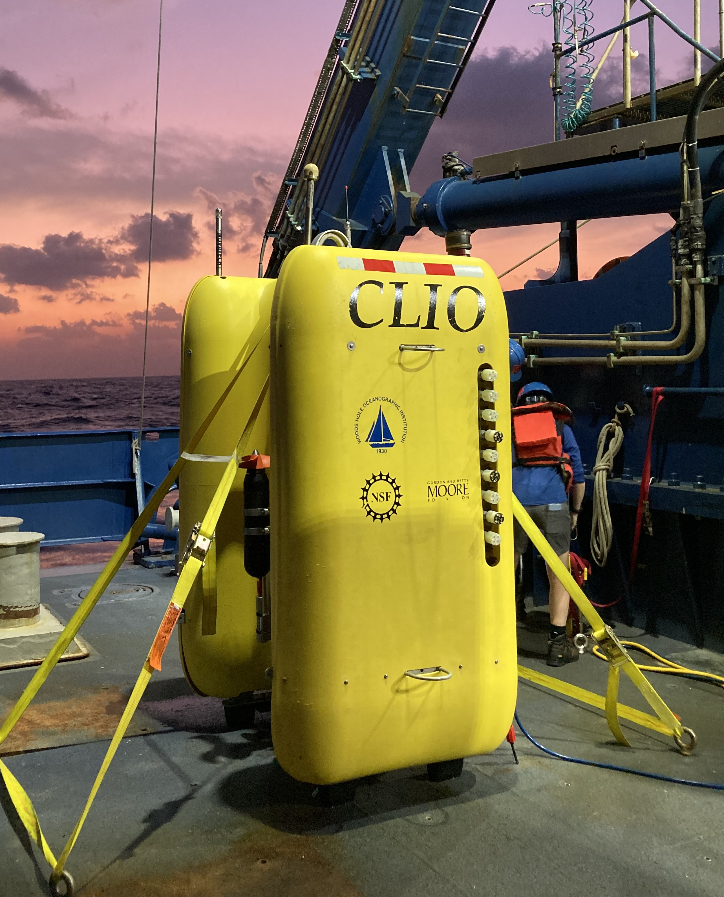

# J. Breier, PE

**Ocean engineer · Autonomous systems · Field robotics**

  
   
  <em>Clio, a 6,000 m autonomous underwater vehicle I led from concept to sea, on deck before a dive (photo credit: M. Saito).</em>

I design, build, and field autonomous marine vehicles and the hardware, electronics, and perception systems that let them work in the real ocean. I've spent more than 20 years taking systems from concept to sea: mechanical and electrical design, prototyping, test, and deployment on expeditions in the Atlantic, Pacific, and Gulf of Mexico.

Currently an **Associate Scientist with Tenure at Woods Hole Oceanographic Institution (WHOI)**, focused on ocean engineering R&D and autonomous systems.

---

### What I work on

- **Autonomous underwater and surface vehicles.** Led end-to-end development of the *Clio* AUV, a 6,000 m autonomous underwater vehicle, from concept through sea trials and science operations.
- **Perception and sensor fusion.** Machine vision combined with conventional navigation sensors for situational awareness on autonomous surface vehicles.
- **Pressure housings and subsea electronics.** Structural (FEA) and thermal design, GD&T applied to function-critical features, and PCB design for deep-ocean enclosures.
- **Field robotics.** Getting hardware to survive and perform at sea, from small-boat work in ship channels to global research expeditions.

### Background

- **Associate Scientist with Tenure**, WHOI (2025 to present)
- **Professor (tenured) and Interim Director**, School of Earth, Environmental, and Marine Sciences, UT Rio Grande Valley (2015 to 2025)
- **Clio AUV development lead**, WHOI (2008 to 2015)
- **U.S. Navy Reserve**: nuclear power officer, Naval Reactors Headquarters; Bettis Reactor Engineering School graduate
- **Licensed Professional Engineer**: Texas and Massachusetts
- Environmental chemistry background, including reaction path modeling, with peer-reviewed publications

<!--
### Featured projects

| Project | What it is |
|---|---|
| [**asv-perception**](https://github.com/USERNAME/asv-perception) | Hands-on perception and sensor fusion for autonomous surface navigation, tested on a BlueRobotics BlueBoat and custom RC hulls |
| [**pressure-housing**](https://github.com/USERNAME/pressure-housing) | Subsea electronics enclosure: CAD, FEA, thermal design, and custom PCB, documented with a formal design-review and release process |
| [**PROJECT-3**](https://github.com/USERNAME/PROJECT-3) | *One line on what it does and why it matters* |
-->

### Tools I use

`SolidWorks / CAD` · `KiCad / PCB design` · `Python` · `C++` · `ROS` · `OpenCV`
<!-- Edit this list to match what you actually use day to day. -->

### Publications

Selected papers are on [Google Scholar](https://scholar.google.com/citations?user=ny6F3vQAAAAJ&hl=en). Recent work includes a co-authored preprint on the value of ocean sample return and lab analysis (EGUsphere, 2026).

### Get in touch

[LinkedIn](https://www.linkedin.com/in/john-breier/) · [WHOI profile](https://www.whoi.edu/cms/files/breier-cv_26283.pdf) · [Email](mailto:jbreier@whoi.edu)
